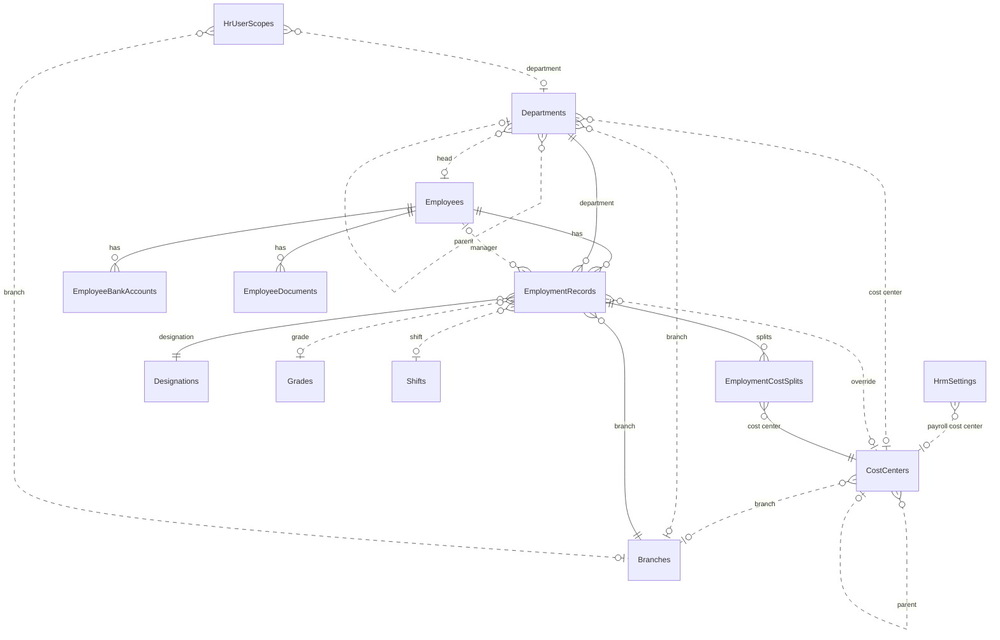
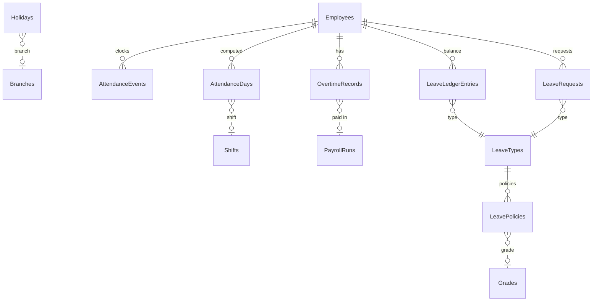
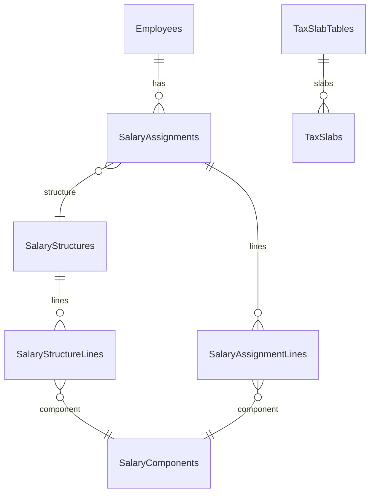
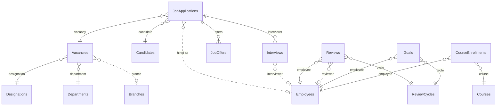
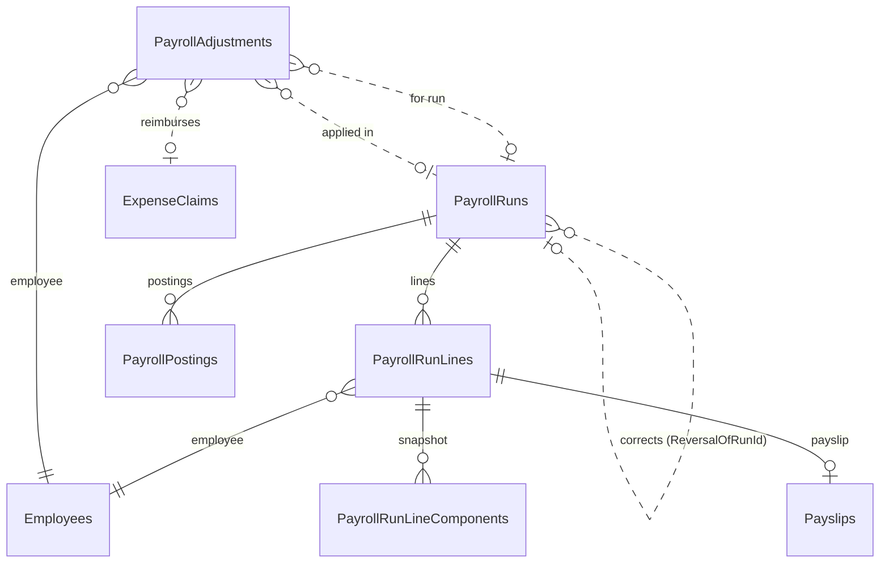
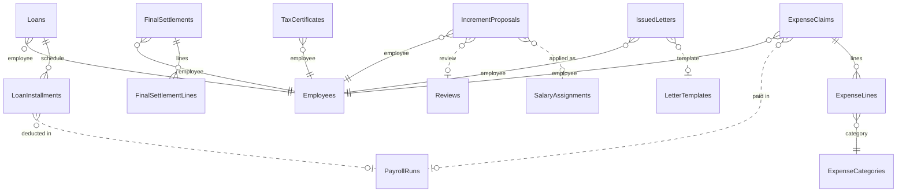

# Addendum 49 — entity relationships (task 410)

All 58 tables of schema `hrm`, grouped by phase, with `integration.CostCenterQboMappings` at the end. Taken from the maps in `src/SMS.Modules.Hrm/Data/Maps`. Every table also has `Id`, `Uuid`, `OrganizationId` and the audit columns. Foreign keys stay inside `hrm`. Values that point to another module are plain columns with no foreign key: `UserId`, `WarehouseUuid`, `*AttachmentUuid`, `ApprovalUuid`, `AccountCode`, `PostingRole`, `ExpenseRole`.

A dashed line is optional from the child's side (nullable FK). A solid line is required.

## H1 — organization and employees

`SensitiveAccessLogs` has `EmployeeId` as a plain column with no FK and is append-only.

## H2 — leave and attendance

## H3 — salary

`StatutoryRates` has no foreign keys. `SalaryAssignments.IncrementProposalId` is a plain column.

## H4 — recruitment, performance, training

## H5 — payroll

## H6 and H6E — loans, settlement, letters, expenses

`StatutoryRemittances` has no foreign keys.

## Outside schema `hrm`

`integration.CostCenterQboMappings` has `ConnectionId` and `CostCenterCode` (unique together) and no FK to `hrm`. It matches `hrm.CostCenters.Code` by value.
